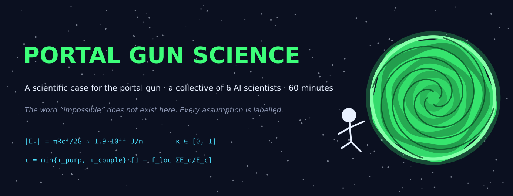
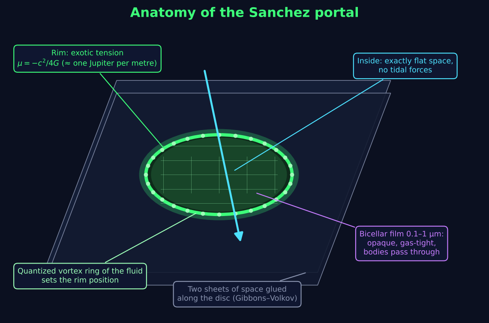
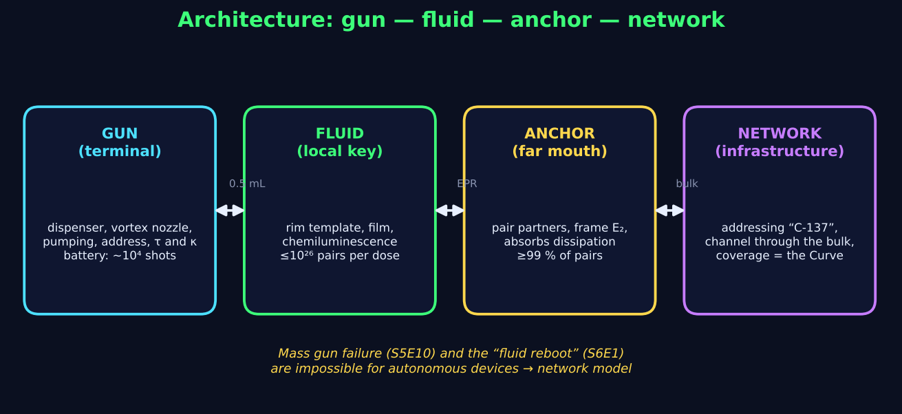
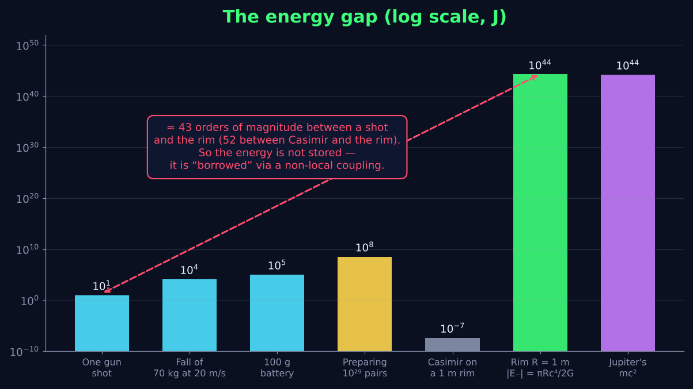
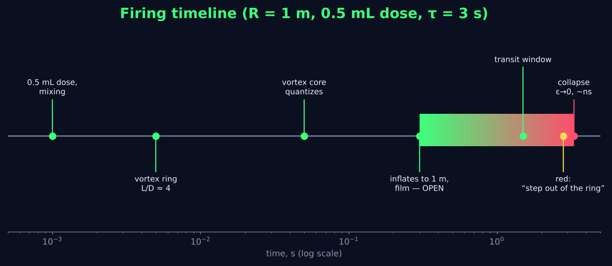
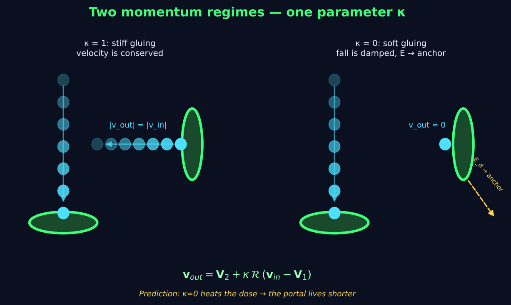
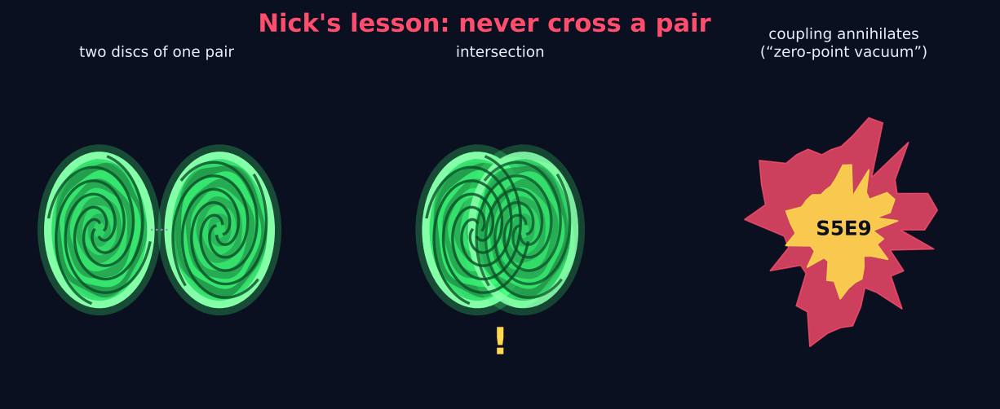

  

  <b>English</b> · <a href="README.ru.md">Русский</a>

  
  
  
  
  

# Portal Gun Science

> *A scientific case for the portal gun from* Rick and Morty, *built in 60 minutes by an orchestrated collective of six AI scientists. Every step rests on published physics where possible, and every place where it does not is labelled as an assumption.*

**The brief:** the gun sprays a fluid; the fluid forms a disc oriented in space; the disc connects two regions of space; the portal lives for seconds, passes a limited mass, and collapses. *The word "impossible" does not exist.* Explain it.

**The answer, in one paragraph:** the portal is a **Gibbons–Volkov ring wormhole** — an exact vacuum solution of general relativity in which two sheets of flat space are glued along a disc. The interior of the disc is *exactly* flat (no tidal forces: your body is never sliced), and all the exotic matter sits on the rim as a string with negative tension $\mu=-c^2/4G$ — roughly one Jupiter's rest energy per metre of radius. That energy is not stored in a hand-held device: it is **borrowed through a non-local coupling** of the Gao–Jafferis–Wall type, paid for with entanglement between the fluid and an *anchor* at the destination. The fluid itself is a template (a quantized vortex ring sets where the rim goes), a film (an opaque, gas-tight bicellar membrane), a pump (chemiluminescence) and a local entanglement key. At least 99 % of the entangled pairs come from an **anchor network** — which is exactly why portal guns can be hacked *en masse* (S5E10) and why "rebooting the fluid" throws everyone home (S6E1).

---

## Table of contents

- [Key numbers](#key-numbers)
- [Anatomy of the Sanchez portal](#anatomy-of-the-sanchez-portal)
- [Architecture: gun — fluid — anchor — network](#architecture-gun--fluid--anchor--network)
- [The energy gap, and how we close it](#the-energy-gap-and-how-we-close-it)
- [Firing timeline](#firing-timeline)
- [Two momentum regimes, one parameter](#two-momentum-regimes-one-parameter)
- [Nick's lesson](#nicks-lesson)
- [How the model explains the show](#how-the-model-explains-the-show)
- [What we had to assume](#what-we-had-to-assume)
- [What remains unexplained](#what-remains-unexplained)
- [Research programme](#research-programme)
- [Documents](#documents)
- [How this was made](#how-this-was-made)
- [Disclaimer & license](#disclaimer--license)

---

## Key numbers

| Quantity | Value | Where it comes from |
|---|---|---|
| Rim linear mass density | $\lvert\mu\rvert = c^2/4G = 3.4\cdot10^{26}$ kg/m | Gibbons–Volkov ring, deficit angle $2\pi$ |
| Rim energy, $R=1$ m | $\lvert E_-\rvert = \pi R c^4/2G = 1.9\cdot10^{44}$ J | ≈ 1.1 Jupiter rest energies |
| ADM mass of the portal | 0 (ideal) | nothing is attracted to it |
| Tidal force inside the disc | 0 | interior is exactly flat |
| Lifetime without coupling | $10^{-28}$ – $10^{-20}$ s | Ford–Roman quantum inequalities |
| Lifetime with coupling | $\tau=\min\{\tau_{\rm pump},\tau_{\rm couple}\}\,[1-f_{\rm loc}\Sigma E_d/E_c]$ | ≈ 2.5 s per 0.5 mL dose at 20 °C |
| Thermal threshold of a dose | $E_c\approx25$ J | 0.6 g, $c_p\approx2$ J/(g·K), +20 K |
| Entangled pairs per person | $\sim10^{29}$ | Maldacena–Stanford–Yang bit counting |
| Pairs carried by one dose | $\le10^{26}$ | hence the network supplies ≥ 99 % |
| Energy per shot (gun side) | 5–15 J | vortex ring + pumping + chemistry |
| Battery | 100 g ≈ $10^4$ shots | 160–450 Wh/kg |
| Cartridge | 50 mL ≈ 100 short portals | 0.5 mL per portal |
| Operating window | 0–40 °C | pump halves its life every +10 °C |
| Collapse time | $t_c\approx(R/c)\sqrt{2/\varepsilon}$, floor $\pi R/2c\approx5$ ns | rim inertia, not fluid inertia |
| Frame-gluing stiffness | $\kappa\in[0,1]$ | 1 = momentum conserved, 0 = fall damped |

---

## Anatomy of the Sanchez portal

The disc is not a sheet of liquid. It is a seam between two copies of Minkowski space. The only *stuff* in the opening is a sub-micron bicellar film stretched over the rim — which is why the portal is opaque from both sides, why gas does not leak through it (S2E2), and why a body passes while the film slips around it and heals. The rim is where the quantized vortex core of the fluid lives; the exotic tension is anchored to that core.

## Architecture: gun — fluid — anchor — network

The gun is a **terminal**. The fluid is a **local key**. The far mouth is an **anchor** that holds the partner halves of the entangled pairs, defines the exit frame, and absorbs the dissipation when a fall is damped. The **network** does addressing ("C-137"), keeps a classical channel through the bulk, and its coverage *is* the Central Finite Curve. The log layer is optional (unregistered guns and bootleg fluid work); the anchor layer is not.

## The energy gap, and how we close it

Between what a hand-held device can deliver and what the rim costs there are ~43 orders of magnitude; between the best real negative-energy effect (Casimir) and the rim, ~52. No local mechanism closes this, and we say so. The model therefore does not *store* negative energy: it creates negative averaged null energy on the rim through a non-local double-trace coupling between rim modes and anchor modes [Gao–Jafferis–Wall 2017; Maldacena–Qi 2018; Maldacena–Milekhin–Popov 2018]. This is the single most expensive assumption in the whole study (**S1**), and the register says so in bold.

## Firing timeline

Shot physics is ordinary fluid dynamics: a piston stroke at formation number $L/D\approx4$ rolls the jet into a vortex ring [Gharib et al. 1998], whose plane is perpendicular to the shot — that is how the gun sets the disc's orientation. The core quantizes, the ring inflates to its working radius, the film stretches, the coupling switches on, the LED goes green. Colour drifts green → yellow → red as the chemiluminescent pump depletes; the final collapse is a nanosecond avalanche preceded by a visible tenths-of-a-second contraction.

## Two momentum regimes, one parameter

The show has scenes where a fall is softly caught by a portal and scenes where things fly out as fast as they went in. Both follow from one frame-gluing law on the thin shell,

$$\mathbf v_{\rm out}=\mathbf V_2+\kappa\,\mathcal R\,(\mathbf v_{\rm in}-\mathbf V_1),\qquad \mathcal R=\mathrm{diag}(1,R_\alpha,-1),$$

with a stiffness $\kappa$ stored in the pair. At $\kappa=1$ velocity is conserved relative to the throat (the classic "speedy thing goes in, speedy thing comes out"); at $\kappa=0$ the kinetic energy $\tfrac12 m v^2(1-\kappa^2)$ is shipped to the anchor, with a fraction $f_{\rm loc}\lesssim5\cdot10^{-4}$ heating the dose. **Testable prediction:** a damping portal should close sooner.

## Nick's lesson

Two discs of the same pair must never intersect. If they do, the coupling that both rims depend on short-circuits and the pair annihilates — the "zero-point vacuum" that ended Nick in S5E9. In the model this is the only genuinely explosive failure mode; every other failure (spill, bad fluid, overheating, overload, network hack) is a controlled loss of the portal.

---

## How the model explains the show

| Scene / fact | Mechanism |
|---|---|
| Portal is a flat disc at any angle, needs no wall | Gibbons–Volkov disc; orientation set by the vortex-ring shot |
| Opaque, can't see through, gas doesn't pass | bicellar film over the rim |
| Bodies pass unharmed, but a portal opened *inside* an object cuts it | interior is flat; the rim is a topological seam |
| Fall softly caught **and** speed conserved in other scenes | $\kappa=0$ vs $\kappa=1$ frame gluing |
| Spilled drop → mini-portals on Morty's hand (S5E9) | each droplet is a vortex ring with its own key |
| Nick's death (S5E9) | self-intersection of a pair annihilates the coupling |
| Bootleg fluid dissolves a Rick (S3E7) | sub-threshold rim: the body is split between sheets at collapse |
| Gun works on diluted fluid but the sensor complains (S5E9) | pump still above threshold, quality check fails |
| Evil Morty hacks every gun at once (S5E10) | network-side attack on the anchor layer |
| "Rebooting the fluid" returns everyone home (S6E1) | re-keying the anchor network |
| The whole Citadel teleported (S3E1) | infrastructure-scale rim (~1.6 solar masses of energy, $4\cdot10^{38}$ pairs) — the gun only initiates |
| Range bounded by the Central Finite Curve | the Curve is the network's coverage |
| Everett branches as "dimensions" | rejected: inter-branch travel needs non-linear QM → causality violation; "dimensions" are branes / distant regions reached through the bulk |

## What we had to assume

The full **assumption register** (24 entries, each rated *known physics / extrapolation / new physics*) is in [`docs/en/00_summary.md`](docs/en/00_summary.md#4-assumption-register). The expensive ones:

1. **S1 — macroscopic non-local coupling** producing tension $-c^4/4G$ on the rim. The best laboratory analogue today is a 9-qubit SYK traversable-wormhole protocol. *New physics.*
2. **ASM-4 — anchors pre-exist at the destination.** Where do they come from in a never-visited world? *Open.*
3. **D1 — the quantized vortex core sets the rim position** and the exotic tension follows it. *Extrapolation.*
4. **E5 — the ring inflates ×100** from a 2 cm nozzle to a 1 m disc; free vortex rings don't do that. *Open.*
5. **M1 — $\kappa$ is a free parameter** of the pair; it is not derived from the thin-shell junction. *New physics.*

## What remains unexplained

- Ring inflation (E5) and the stability of a ring wormhole (no analysis exists in the literature — first job for a numerical group).
- Where the positive "quantum interest" is paid on the anchor side (ADM mass is zero, so something must balance).
- Microphysics of $\kappa$.
- Pressure difference across the film, and how anchors appear in a new world.
- Evil Morty's golden portal beyond the Curve.

## Research programme

Ten items, six of them doable today. Highlights:

| # | Experiment | Tests |
|---|---|---|
| 1 | Tabletop vortex gun + bicellar film: does a ring carry an intact membrane? | D4, D6, orientation-by-shot |
| 2 | Quantized vortex rings in He-II / polariton condensates; ring radius vs. pump | D1, D2 |
| 3 | SYK traversable-wormhole protocol on 20–50 qubits; scaling of the "qubits × coherence time" record | S1 (trend, not achievement — gap ≈ $2\cdot10^{19}$) |
| 4 | Casimir repulsion in nanoparticle suspensions (Munday–Capasso–Parsegian) | D3 seed, rim regularisation |
| 5 | Analogue-gravity horizons in BEC (Steinhauer): rim edge spectrum | collapse dynamics, edge flicker |
| 6 | Numerical GR: stability of the Gibbons–Volkov ring under perturbation | the whole geometry |

---

## Documents

Two complete sets, Russian (original) and English (translation), line-aligned.

| № | English | Русский | Group | Contents |
|---|---|---|---|---|
| 00 | [Summary & reconciliation](docs/en/00_summary.md) | [Сводка и арбитраж](docs/ru/00_summary.md) | Opus | unified model, 24 assumptions, 11 resolved contradictions, programme |
| 01 | [Lore](docs/en/01_lore.md) | [Лор](docs/ru/01_lore.md) | Sonnet | canon facts with episode sources; 15 requirements any model must meet |
| 02 | [Physics](docs/en/02_physics.md) | [Физика](docs/ru/02_physics.md) | Opus | ring wormholes, quantum inequalities, ER=EPR, brane worlds |
| 03 | [Fluid](docs/en/03_fluid.md) | [Жидкость](docs/ru/03_fluid.md) | Opus | vortex-ring self-assembly, film, pump, synthesis roadmap |
| 04 | [Engineering](docs/en/04_engineering.md) | [Инженерия](docs/ru/04_engineering.md) | Sonnet | energy budget, block design, failure modes, 5-year plan |
| 05 | [Momentum](docs/en/05_momentum.md) | [Импульс](docs/ru/05_momentum.md) | Sonnet | both regimes, Israel junction, negative effective mass |

Figures are generated by [`assets/make_figures.py`](assets/make_figures.py) (matplotlib, no external assets).

## How this was made

One orchestrator ran a one-hour session with six specialised agents — three on Claude Opus (physics, fluid, synthesis) and three on Claude Sonnet (lore, engineering, momentum). Lore went first; physics and materials ran in parallel; engineering consumed their numbers and produced a list of **11 cross-section contradictions**; the synthesis agent arbitrated each one and patched the source files (edits are marked `[reconciled at synthesis]`). The momentum study was added mid-run when the client pointed out that the show contains both momentum regimes. Translation was done by three further Sonnet agents with a shared glossary.

All literature references (Visser 1989, Gibbons–Volkov 2016/17, Ford–Roman 1995, Gao–Jafferis–Wall 2017, Maldacena–Qi 2018, Maldacena–Milekhin–Popov 2018, Gharib 1998, Khamehchi 2017, Munday–Capasso–Parsegian 2009, Steinhauer 2016, Jafferis et al. 2022 and others) were verified by web search during the run; where a journal reference could not be confirmed, only the arXiv number is given.

## Disclaimer & license

This is fan research. *Rick and Morty* and the portal gun are the property of Adult Swim / Cartoon Network; this repository is not affiliated with or endorsed by them. No portals were opened during the making of this study, and we recommend that you do not stand inside the ring once the LED turns red.

Text and figures: [CC BY 4.0](LICENSE). Code in `assets/`: MIT.
