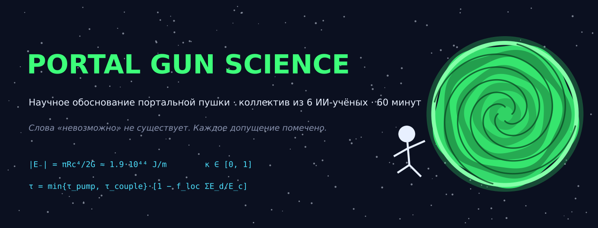
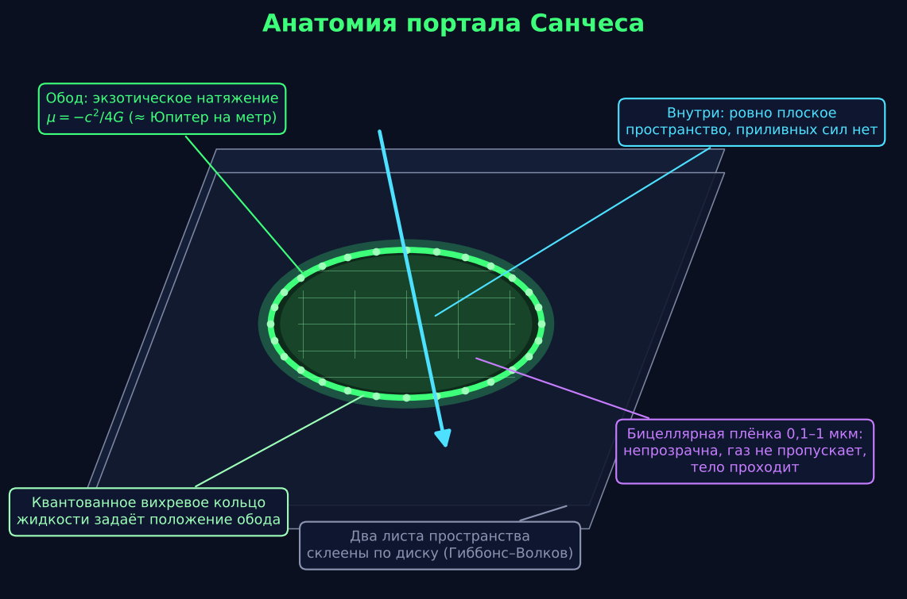
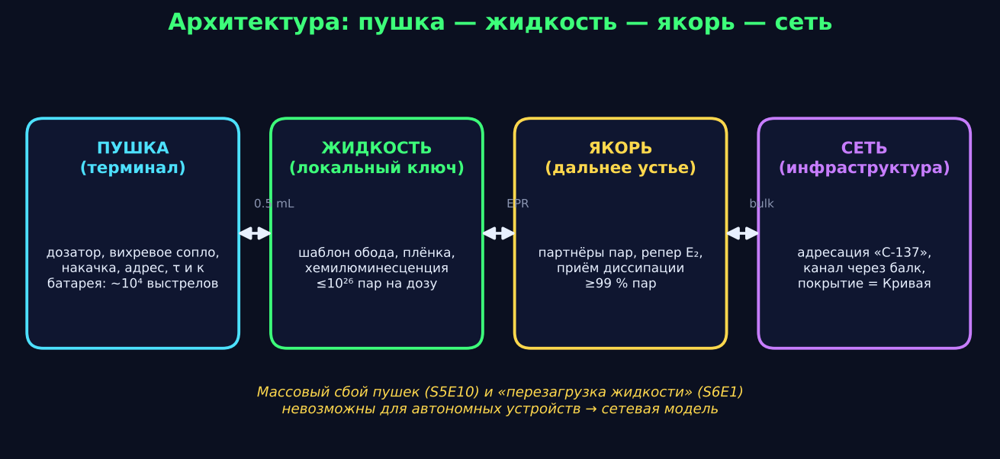
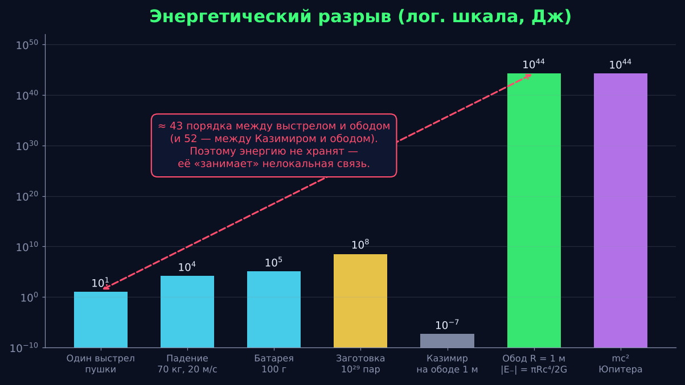
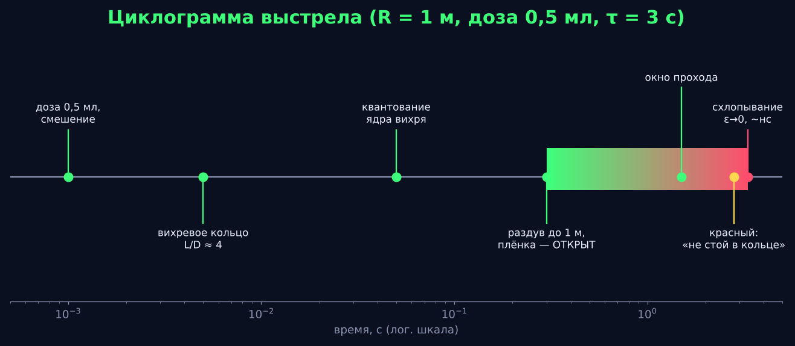
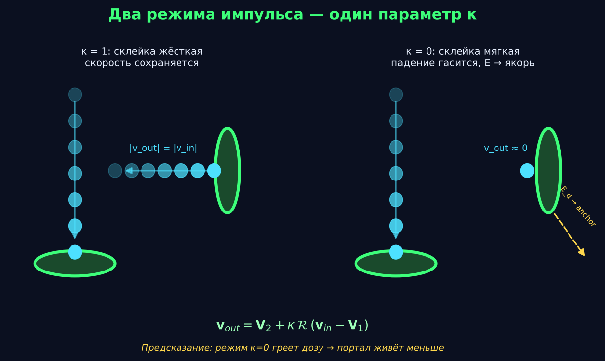
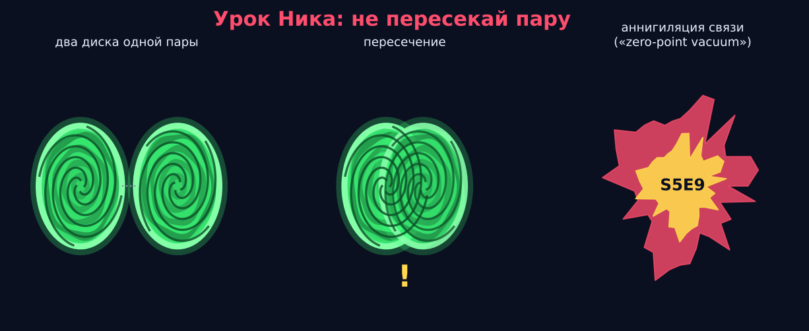

  

  <a href="README.md">English</a> · <b>Русский</b>

  
  
  
  
  

# Portal Gun Science

> *Научное обоснование портальной пушки из* «Рика и Морти», *собранное за 60 минут оркестрированным коллективом из шести ИИ-учёных. Везде, где можно, модель опирается на опубликованную физику; везде, где нельзя, — честно помечено допущением.*

**Задание:** пушка распыляет жидкость; жидкость принимает форму ориентированного в пространстве диска; диск связывает две области пространства; портал живёт секунды, пропускает ограниченную массу и схлопывается. *Слова «невозможно» не существует.* Объяснить.

**Ответ в одном абзаце:** портал — **кольцевая червоточина Гиббонса–Волкова**, точное вакуумное решение ОТО, в котором два листа плоского пространства склеены по диску. Внутри диска пространство *ровно* плоское (приливных сил нет — тело никогда не режется), а вся экзотика сидит на ободе в виде струны с отрицательным натяжением $\mu=-c^2/4G$ — примерно энергия покоя Юпитера на метр радиуса. Эту энергию не хранят в ручном приборе: её **занимают через нелокальную связь** типа Гао–Джеффериса–Уолла, оплаченную запутанностью между жидкостью и *якорем* в точке назначения. Сама жидкость — это шаблон (квантованное вихревое кольцо задаёт положение обода), плёнка (непрозрачная газонепроницаемая бицеллярная мембрана), накачка (хемилюминесценция) и локальный ключ запутанности. Не менее 99 % запутанных пар поставляет **сеть якорей** — именно поэтому пушки можно взломать все разом (S5E10), а «перезагрузка жидкости» возвращает всех по домам (S6E1).

---

## Содержание

- [Ключевые числа](#ключевые-числа)
- [Анатомия портала Санчеса](#анатомия-портала-санчеса)
- [Архитектура: пушка — жидкость — якорь — сеть](#архитектура-пушка--жидкость--якорь--сеть)
- [Энергетический разрыв и как мы его закрываем](#энергетический-разрыв-и-как-мы-его-закрываем)
- [Циклограмма выстрела](#циклограмма-выстрела)
- [Два режима импульса, один параметр](#два-режима-импульса-один-параметр)
- [Урок Ника](#урок-ника)
- [Как модель объясняет сериал](#как-модель-объясняет-сериал)
- [Что пришлось допустить](#что-пришлось-допустить)
- [Что остаётся необъяснённым](#что-остаётся-необъяснённым)
- [Программа исследований](#программа-исследований)
- [Документы](#документы)
- [Как это делалось](#как-это-делалось)
- [Отказ от ответственности и лицензия](#отказ-от-ответственности-и-лицензия)

---

## Ключевые числа

| Величина | Значение | Откуда |
|---|---|---|
| Линейная плотность массы обода | $\lvert\mu\rvert = c^2/4G = 3{,}4\cdot10^{26}$ кг/м | кольцо Гиббонса–Волкова, угол дефицита $2\pi$ |
| Энергия обода, $R=1$ м | $\lvert E_-\rvert = \pi R c^4/2G = 1{,}9\cdot10^{44}$ Дж | ≈ 1,1 энергии покоя Юпитера |
| ADM-масса портала | 0 (идеал) | портал ничего не притягивает |
| Приливные силы в проёме | 0 | внутри ровно плоско |
| Время жизни без связи | $10^{-28}$ – $10^{-20}$ с | квантовые неравенства Форда–Романа |
| Время жизни со связью | $\tau=\min\{\tau_{\rm pump},\tau_{\rm couple}\}\,[1-f_{\rm loc}\Sigma E_d/E_c]$ | ≈ 2,5 с на дозу 0,5 мл при 20 °C |
| Тепловой порог дозы | $E_c\approx25$ Дж | 0,6 г, $c_p\approx2$ Дж/(г·К), +20 К |
| Запутанных пар на человека | $\sim10^{29}$ | подсчёт битов по Малдасене–Стэнфорду–Янгу |
| Пар в одной дозе | $\le10^{26}$ | поэтому сеть даёт ≥ 99 % |
| Энергия выстрела (на стороне пушки) | 5–15 Дж | вихревое кольцо + накачка + химия |
| Батарея | 100 г ≈ $10^4$ выстрелов | 160–450 Вт·ч/кг |
| Картридж | 50 мл ≈ 100 коротких порталов | 0,5 мл на портал |
| Рабочее окно | 0–40 °C | ресурс накачки вдвое меньше на каждые +10 °C |
| Время схлопывания | $t_c\approx(R/c)\sqrt{2/\varepsilon}$, нижний предел $\pi R/2c\approx5$ нс | инерция обода, а не жидкости |
| Жёсткость склейки реперов | $\kappa\in[0,1]$ | 1 — импульс сохраняется, 0 — падение гасится |

---

## Анатомия портала Санчеса

Диск — не слой жидкости. Это шов между двумя копиями пространства Минковского. Единственное *вещество* в проёме — субмикронная бицеллярная плёнка, натянутая на обод: поэтому портал непрозрачен с обеих сторон, поэтому через него не идёт газ (S2E2), и поэтому тело проходит, а плёнка расступается вокруг него и затягивается. На ободе живёт квантованное ядро вихря жидкости; экзотическое натяжение привязано к этому ядру.

## Архитектура: пушка — жидкость — якорь — сеть

Пушка — **терминал**. Жидкость — **локальный ключ**. Дальнее устье — **якорь**: он хранит вторые половины запутанных пар, задаёт выходной репер и принимает диссипацию при гашении падения. **Сеть** занимается адресацией («C-137»), держит классический канал через балк, и её покрытие *и есть* Центральная Конечная Кривая. Слой журнала необязателен (незарегистрированные пушки и контрабандная жидкость работают); слой якорей обязателен.

## Энергетический разрыв и как мы его закрываем

Между тем, что может выдать ручной прибор, и тем, что стоит обод, — ~43 порядка; между лучшим реальным эффектом отрицательной энергии (Казимир) и ободом — ~52. Ни один локальный механизм этого не закрывает, и мы так и пишем. Поэтому модель не *хранит* отрицательную энергию: она создаёт отрицательную усреднённую нулевую энергию на ободе через нелокальную двухследовую связь между модами обода и модами якоря [Гао–Джефферис–Уолл 2017; Малдасена–Ци 2018; Малдасена–Милехин–Попов 2018]. Это самое дорогое допущение всего исследования (**С1**), и в реестре оно выделено жирным.

## Циклограмма выстрела

Физика выстрела — обычная гидродинамика: ход поршня при числе формирования $L/D\approx4$ сворачивает струю в вихревое кольцо [Gharib et al. 1998], плоскость которого перпендикулярна выстрелу — так пушка задаёт ориентацию диска. Ядро квантуется, кольцо раздувается до рабочего радиуса, натягивается плёнка, включается связь, LED зеленеет. Цвет уходит зелёный → жёлтый → красный по мере истощения хемилюминесцентной накачки; финальное схлопывание — наносекундная лавина после видимого стягивания в десятые доли секунды.

## Два режима импульса, один параметр

В сериале есть сцены, где портал мягко ловит падение, и сцены, где предметы вылетают с той же скоростью, с какой влетели. Оба случая следуют из одного закона склейки реперов на тонкой оболочке,

$$\mathbf v_{\rm out}=\mathbf V_2+\kappa\,\mathcal R\,(\mathbf v_{\rm in}-\mathbf V_1),\qquad \mathcal R=\mathrm{diag}(1,R_\alpha,-1),$$

с жёсткостью $\kappa$, хранящейся в паре. При $\kappa=1$ скорость сохраняется относительно горловины (классическое «speedy thing goes in, speedy thing comes out»); при $\kappa=0$ кинетическая энергия $\tfrac12 m v^2(1-\kappa^2)$ уходит к якорю, а доля $f_{\rm loc}\lesssim5\cdot10^{-4}$ греет дозу. **Проверяемое предсказание:** гасящий портал закрывается раньше.

## Урок Ника

Два диска одной пары никогда не должны пересекаться. Если это происходит, связь, на которой держатся оба обода, замыкается накоротко, и пара аннигилирует — тот самый «zero-point vacuum», который прикончил Ника в S5E9. В модели это единственный по-настоящему взрывной режим отказа; все остальные (пролив, плохая жидкость, перегрев, перегруз, взлом сети) — контролируемая потеря портала.

---

## Как модель объясняет сериал

| Сцена / факт | Механизм |
|---|---|
| Портал — плоский диск под любым углом, стена не нужна | диск Гиббонса–Волкова; ориентацию задаёт вихревое кольцо выстрела |
| Непрозрачен, не просматривается, газ не проходит | бицеллярная плёнка на ободе |
| Тело проходит невредимым, но портал, открытый *внутри* предмета, режет его | внутри плоско; обод — топологический шов |
| Падение мягко гасится **и** скорость сохраняется в других сценах | склейка реперов при $\kappa=0$ и $\kappa=1$ |
| Пролитая капля → мини-порталы на ладони Морти (S5E9) | каждая капля — вихревое кольцо со своим ключом |
| Смерть Ника (S5E9) | самопересечение пары аннигилирует связь |
| Контрафактная жидкость растворяет Рика (S3E7) | подпороговый обод: при схлопывании тело делится между листами |
| Пушка работает на разбавленной жидкости, но датчик ругается (S5E9) | накачка ещё выше порога, контроль качества не пройден |
| Evil Morty взламывает все пушки разом (S5E10) | атака на слой якорей со стороны сети |
| «Перезагрузка жидкости» возвращает всех домой (S6E1) | перепрошивка ключей сети якорей |
| Телепортирована вся Цитадель (S3E1) | обод инфраструктурного масштаба (~1,6 масс Солнца в энергии, $4\cdot10^{38}$ пар) — пушка только инициирует |
| Дальность ограничена Центральной Конечной Кривой | Кривая — покрытие сети |
| Ветви Эверетта как «измерения» | отвергнуто: переход между ветвями требует нелинейной КМ → нарушение причинности; «измерения» — браны / далёкие области, достижимые через балк |

## Что пришлось допустить

Полный **реестр допущений** (24 записи, каждая с оценкой *известная физика / экстраполяция / новая физика*) — в [`docs/ru/00_summary.md`](docs/ru/00_summary.md#4-реестр-допущений). Самые дорогие:

1. **С1 — макроскопическая нелокальная связь**, дающая натяжение $-c^4/4G$ на ободе. Лучший лабораторный аналог сегодня — 9-кубитный SYK-протокол проходимой червоточины. *Новая физика.*
2. **ДОП-4 — якоря заранее стоят в точке назначения.** Откуда они берутся в никогда не посещённом мире? *Открыто.*
3. **D1 — квантованное ядро вихря задаёт положение обода**, и экзотическое натяжение следует за ним. *Экстраполяция.*
4. **Э5 — кольцо раздувается в 100 раз** от сопла 2 см до диска 1 м; свободные вихревые кольца так не делают. *Открыто.*
5. **М1 — $\kappa$ свободный параметр** пары; из условий склейки тонкой оболочки он не выводится. *Новая физика.*

## Что остаётся необъяснённым

- Раздув кольца (Э5) и устойчивость кольцевой червоточины (в литературе анализа нет — первая задача для численной группы).
- Где на стороне якоря платится положительный «квантовый процент» (ADM-масса нулевая, значит, что-то должно балансировать).
- Микрофизика $\kappa$.
- Перепад давления на плёнке и появление якорей в новом мире.
- Золотой портал Evil Morty за пределами Кривой.

## Программа исследований

Десять пунктов, шесть из них выполнимы сегодня. Главное:

| # | Эксперимент | Что проверяет |
|---|---|---|
| 1 | Настольная вихревая пушка + бицеллярная плёнка: уносит ли кольцо целую мембрану? | D4, D6, ориентация по выстрелу |
| 2 | Квантованные вихревые кольца в He-II / поляритонных конденсатах; радиус кольца vs накачка | D1, D2 |
| 3 | SYK-протокол проходимой червоточины на 20–50 кубитах; тренд рекорда «кубиты × время когерентности» | С1 (тренд, не достижение — разрыв ≈ $2\cdot10^{19}$) |
| 4 | Казимировское отталкивание в суспензиях наночастиц (Munday–Capasso–Parsegian) | затравка D3, регуляризация обода |
| 5 | Аналоговые горизонты в БЭК (Steinhauer): спектр кромки обода | динамика схлопывания, мерцание края |
| 6 | Численная ОТО: устойчивость кольца Гиббонса–Волкова к возмущениям | вся геометрия |

---

## Документы

Два полных комплекта — русский (оригинал) и английский (перевод), построчно выровненные.

| № | Русский | English | Группа | Содержание |
|---|---|---|---|---|
| 00 | [Сводка и арбитраж](docs/ru/00_summary.md) | [Summary & reconciliation](docs/en/00_summary.md) | Opus | единая модель, 24 допущения, 11 разрешённых противоречий, программа |
| 01 | [Лор](docs/ru/01_lore.md) | [Lore](docs/en/01_lore.md) | Sonnet | факты канона с эпизодами; 15 требований к любой модели |
| 02 | [Физика](docs/ru/02_physics.md) | [Physics](docs/en/02_physics.md) | Opus | кольцевые червоточины, квантовые неравенства, ER=EPR, браны |
| 03 | [Жидкость](docs/ru/03_fluid.md) | [Fluid](docs/en/03_fluid.md) | Opus | самосборка вихревого кольца, плёнка, накачка, дорожная карта синтеза |
| 04 | [Инженерия](docs/ru/04_engineering.md) | [Engineering](docs/en/04_engineering.md) | Sonnet | энергобаланс, блочная конструкция, режимы отказа, план на 5 лет |
| 05 | [Импульс](docs/ru/05_momentum.md) | [Momentum](docs/en/05_momentum.md) | Sonnet | оба режима, условия Израэля, отрицательная эффективная масса |

Иллюстрации генерирует [`assets/make_figures.py`](assets/make_figures.py) (matplotlib, без внешних ресурсов).

## Как это делалось

Один оркестратор провёл часовую сессию с шестью специализированными агентами — три на Claude Opus (физика, жидкость, синтез) и три на Claude Sonnet (лор, инженерия, импульс). Сначала лор; физика и материаловедение параллельно; инженеры взяли их числа и выдали список **11 противоречий между разделами**; агент-синтезатор разрешил каждое и внёс правки в исходные файлы (помечены `[согласовано при синтезе]`). Направление по импульсу добавлено по ходу работы, когда заказчик указал, что в сериале есть оба режима. Перевод выполнили ещё три агента Sonnet с общим глоссарием.

Все ссылки на литературу (Visser 1989, Gibbons–Volkov 2016/17, Ford–Roman 1995, Gao–Jafferis–Wall 2017, Maldacena–Qi 2018, Maldacena–Milekhin–Popov 2018, Gharib 1998, Khamehchi 2017, Munday–Capasso–Parsegian 2009, Steinhauer 2016, Jafferis et al. 2022 и др.) проверялись поиском по ходу работы; там, где журнальную ссылку подтвердить не удалось, дан только номер arXiv.

## Отказ от ответственности и лицензия

Это фанатское исследование. «Рик и Морти» и портальная пушка принадлежат Adult Swim / Cartoon Network; репозиторий с ними не связан и ими не одобрен. Ни один портал при подготовке исследования открыт не был, и мы не рекомендуем стоять в кольце после того, как LED стал красным.

Текст и иллюстрации: [CC BY 4.0](LICENSE). Код в `assets/`: MIT.
